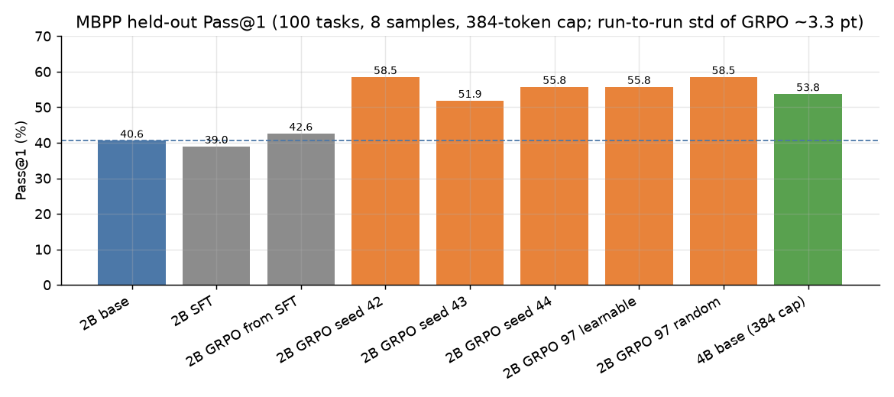
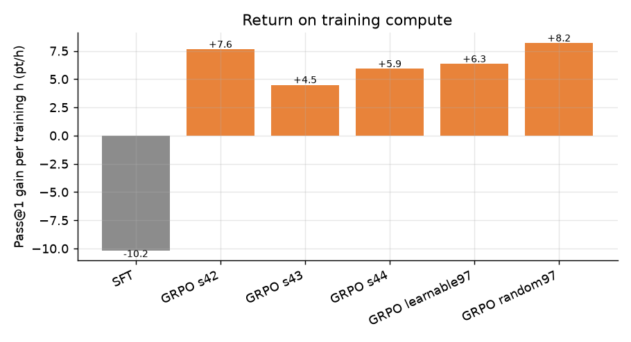

# Local LLM Lab: Small-Model RL for Code

**Can a 2B-parameter model get meaningfully better at writing verified Python code using only free-tier compute, and which intervention gives the most gain per GPU hour?**

A reproducible research framework that post-trains **Qwen3.5-2B** with GRPO (reinforcement learning from unit-test rewards), compares it against SFT, hard-example mining, test-time scaling, tool-using agents and a 4B model, and reports every result with confidence intervals. The whole study ran on Kaggle's free T4 GPUs in **about 23.8 GPU hours**.



## Headline results

Held-out MBPP, 100 frozen tasks, 8 samples per task, temperature 0.7, 384-token cap.

| Model | Pass@1 | Pass@4 | Pass@8 | Train GPU h |
| :--- | ---: | ---: | ---: | ---: |
| Qwen3.5-2B base | 40.6% | 61.4% | 69.0% | - |
| 2B + SFT | 39.0% | 57.6% | 65.0% | 0.16 |
| 2B + GRPO (mean of 3 seeds) | **55.4% ± 3.3** | 71.8% | 76.0% | ~2.5 each |
| Qwen3.5-4B base (384-token cap, lower bound) | 53.8% | 66.2% | 69.0% | - |

- **RL with unit-test rewards works:** +14.8 Pass@1 points over base across three seeds (range +11 to +18), about 6 points per training GPU hour. The first run's +17.9 was the best seed, so it is not the number to quote.
- **SFT first does not help:** it was 1.6 points below base, and GRPO started from the SFT checkpoint was far worse than GRPO from base.
- **Train or sample?** One GRPO sample is worth about four base samples chosen with the visible test, and the trained model stays ahead at equal k.
- **Hard-example mining ties random selection:** it cut wasted groups from 61% to 40%, but 97 random tasks matched all 256 (-2.8 points, within seed noise).
- **Agents help at 4B, not 2B:** a tool loop with test feedback gave +23 points at 4B (39 tasks) and no significant change at 2B.
- **The gain is task-style specific:** it survives renaming functions (+13 points) but **does not transfer to HumanEval** (+2.4 points, CI [-0.8, +5.5]).
- **Bigger still wins:** the 4B model is about 27 points above 2B base at an adequate token cap. GRPO closes more than half of that gap. 4B GRPO was a no-go (8.9 projected hours against a 5 h budget).



Limitations are listed [below](#limitations); please read them before quoting any number.

## What makes it trustworthy

- **Frozen, hashed data.** The held-out set is never modified. Every data file's SHA-256 is in [`MANIFEST.sha256`](kaggle/datasets/llm-lab-data/MANIFEST.sha256), with leakage audits between train, dev and test.
- **Statistics, not point estimates.** Paired bootstrap confidence intervals, unbiased Pass@k, and three training seeds, so the gap that counts is the one larger than seed noise (3.3 points).
- **Sandboxed execution.** Generated code never runs on the host. It runs in an isolated, offline container with CPU, memory and time limits.
- **Reward is only unit tests.** One reward term (all tests pass), no shaping.
- **Every run is reproducible.** Unique experiment IDs, saved configs, recorded parent checkpoints, and a notebook generator per experiment.
- **Mistakes are documented.** An early local prototype used a prompt that never named the function the tests call, so its MBPP numbers were invalid. The Kaggle re-run found and fixed this (base Pass@1 went from 2.9% to 40.6%). A hidden 90% truncation of 4B outputs briefly reversed a conclusion until it was caught. Both are written up.

## Experiments

| Question | Experiment | Result |
| :--- | :--- | :--- |
| Baseline capability | NB 03 | 2B 40.6% / 4B 53.8% (384 cap) |
| Does SFT help? | NB 04-05 | No (39.0%) |
| Does GRPO help? | NB 06-07, seeds 42/43/44 | +14.8 pt, std 3.3 |
| Does mining help? | NB 08, x06 | Tie with random |
| Sample or train? | NB 09, 09b | 1 GRPO sample ≈ 4 base samples |
| Do agents help? | NB 10-11 | 4B yes (+23), 2B no |
| Generalisation | x02 HumanEval, x07 renaming | Renaming ok, HumanEval no |
| Token-cap confound | x03, x04 | 4B +15 pt at 768 tokens, 2B none |
| Train 4B with GRPO? | x08s | No-go (about 9 h vs 5 h budget) |

## Repository layout

```text
kaggle/
  datasets/llm-lab-utils/   shared library: verifier, evaluator, GRPO/SFT helpers, metrics
  datasets/llm-lab-data/    frozen data + SHA-256 manifest
  kernels/                  generated Kaggle notebooks (one folder per experiment)
  tools/                    notebook generators, dashboard and analysis scripts
  scripts/                  sync / push / pull helpers for the Kaggle CLI
  tests/                    unit tests (23)
reports/                    final_results.{csv,md,json} and figures
docs/
  blog/                     9-part write-up of the study
  EXPERIMENT_LOG.md         full per-phase log with every metric
  kaggle_migration_plan.md  plan and change log
src/llm_lab/                original local-GPU prototype (Phases 0-6)
```

## Reproduce

```bash
python -m pytest kaggle/tests                       # unit tests
python kaggle/tools/make_dashboard.py               # regenerate tables and figures (CPU)
```

To run an experiment on Kaggle (needs the Kaggle CLI and a phone-verified account for GPU access):

```powershell
kaggle/scripts/sync_all.ps1                          # upload the shared library and frozen data
python kaggle/tools/build_nb06.py                    # generate a notebook
kaggle/scripts/push_kernel.ps1 06-grpo-training -Accelerator NvidiaTeslaT4 -TimeoutSeconds 18000
```

## Local prototype vs Kaggle runs

The first version ran on a local 8 GB RTX 2060 SUPER with 4-bit quantisation (`src/llm_lab`, Phases 0-6). It validated the pipeline, but its benchmark was a saturated synthetic set and its MBPP prompt was flawed. **All headline numbers come from the Kaggle re-run**, which uses fp16, a corrected prompt, a larger frozen MBPP evaluation set, and multiple seeds. The local record is kept in [docs/EXPERIMENT_LOG.md](docs/EXPERIMENT_LOG.md) as history.

## Limitations

- 100 evaluation tasks: one comparison has a 95% CI of about ±6 points, and the seed standard deviation of a GRPO model is 3.3 points. Differences smaller than that are not claimed.
- One model family (Qwen3.5), one training source (256 MBPP tasks), one benchmark family. HumanEval covers 157 of 164 problems.
- The 4B results are lower bounds at the 384-token cap. At 768 tokens they cover 73 tasks, and the 4B agent run completed 39 of 60 tasks.
- A second training source to test HumanEval transfer was not run. It is the first thing to do next.
- The hypothesis that GRPO learned to match the example assert's format was not tested.

## More

- [Blog series](docs/blog/README.md): nine posts walking through the study.
- [Full experiment log](docs/EXPERIMENT_LOG.md): every phase, metric and analysis.
- [Final results table](reports/final_results.md) and [CSV](reports/final_results.csv), including peak VRAM, peak RAM, wall time and GPU hours per experiment.
- Project rules: [AGENTS.md](AGENTS.md).
