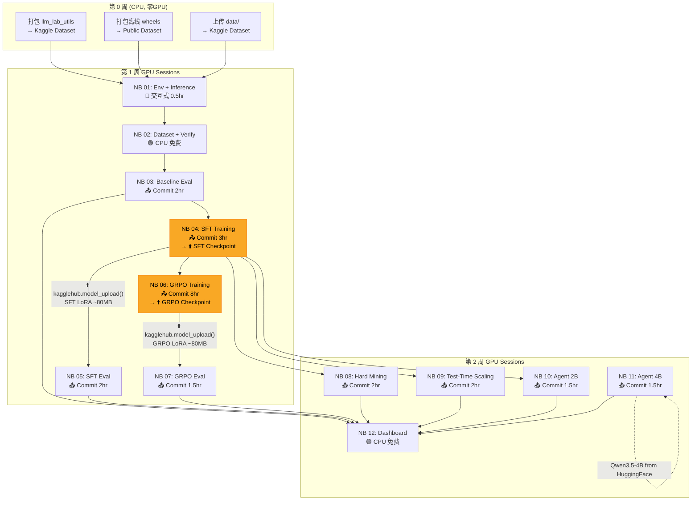
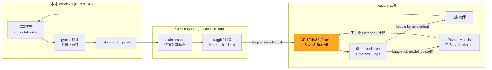

# Local LLM Lab → Kaggle 迁移计划 v2

> **目标**：将本地完成的 local-llm-lab 研究项目（Phase 0-7）重组为 12 个可独立运行的 Kaggle Notebook，搭配共享 Python 库，形成可复现的教学文档和博客系列。
>
> **核心策略**：充分利用 Kaggle 的六大免费额度（T4×2 双卡 32GB 显存、$10/天 AI Models、214.75 GB 私有存储），将本地 8GB 显卡的妥协方案升级为**无量化噪声的 bf16 LoRA + vLLM 加速 GRPO rollout**。

---

## 0. 修订记录（实测结果优先于下文旧假设）

> 下文章节保留原始设计思路；与本节冲突时，**以本节为准**。

| # | 原假设 | 实测 / 修正 | 状态 |
|:--|:---|:---|:---|
| 1 | 目录为 `kaggle/llm_lab_utils/` | Kaggle 挂载 Dataset 根目录，包必须嵌套：`kaggle/datasets/<slug>/llm_lab_utils/`；`sys.path.insert(0, '/kaggle/input/llm-lab-utils')` | 已实现 |
| 2 | 打包完整离线 wheel（含 vllm） | Kaggle 镜像（Python 3.13, torch 2.11, transformers 5.16.1, peft 0.20.0）已含大部分依赖。仅需 6 个包：trl, bitsandbytes, accelerate, datasets, psutil, tqdm（45 MB）。用 `pip --dry-run --report` 求差集，绝不下载 torch/nvidia/triton | 已完成 (`00-build-wheels`) |
| 3 | **vLLM 双卡分流 (3-5x)** | **取消。** 安装 vLLM 会变更 105 个包并把 torch 2.11 替换为 2.13 + CUDA 13，可能破坏环境。NB 06 改用 HF `generate`（可用双卡 `device_map` 或 policy/rollout 分卡），GRPO 耗时估计需重算 | 已决定 |
| 4 | bf16 LoRA 无量化噪声 | **实测 (NB 01b)**：T4 上 rollout 吞吐 bf16 **28.7 tok/s** vs fp16 **73.1 tok/s**（bf16 两次完全复现，fp16 快 2.5x）。**结论：全项目用 fp16（已验证）**。**训练步 (2×512 tok, LoRA r=16, grad ckpt)：fp16 1.9 s vs bf16 6.4–6.8 s（3.5x）**，fp16 loss 有限无溢出，峰值显存 7.1 GB。注意 fp16 GradScaler 初期会跳步，NB 04 需对比 loss 曲线。2B 模型 fp16 仅 3.8 GB（NF4 1.8 GB），单卡 15 GB 绝对够用，**不需要量化** | 部分验证 |
| 5 | GRPO 6-8 hr、总计 18-24 GPU hr | 本地实测：SFT 5K = 3.04 GPU hr；GRPO ≈ 54 s/step、3250 步 ≈ 45 hr。Kaggle 预算见 §0.1；**GRPO 先做 20 步冒烟标定 s/step，再决定总步数** | 见 §0.1 |
| 9 | MBPP 复杂题可用于评测 | **NB 02 审计发现**：(a) 420 题中仅 14 题的 prompt 含测试所需函数名，模型无法知道要定义 `get_ludic` 等 → Phase 4 的 "420/420 impossible" 很可能是 prompt 设计缺陷而非 2B 能力上限，后续 Phase 5/6 的 10%/20%/30% 数字同样存疑；(b) 14/420 题的 reference solution 自身通不过（truthy assert、缺 import、超时）。**修复**：新文件 `train_complex_v2.jsonl`（prompt 附 1 条示例测试，剔除 14 题，406 题），旧文件保持不变。**NB 03 实测验证**：同 100 题、同模型 (Qwen3.5-2B fp16)，v1 prompt Pass@1 **2.9%** / Pass@8 7% → v2 prompt Pass@1 **40.6%** / Pass@4 61.4% / Pass@8 69%；v1 下 84.3% 的样本报 "name not defined"，v2 降至 9.5%。**结论成立：Phase 4 的 "100% impossible" 是 prompt 缺陷，不是能力上限** | 已验证 |
| 10 | 合成数据集有区分度 | 仅 4 个 prompt 模板；train/dev/test ID 互相重叠（ID 不可作 join key）；约一半 test 题与 train 题 prompt+visible test 完全相同 → Baseline/SFT/GRPO 全部 100% 是饱和而非能力证据。冻结 test 集不改动，仅在文档中披露 | 已记录 |
| 11 | Kaggle 仅 13 GB RAM | 实测 33.7 GB RAM、2×T4 各 15.6 GB、Python 3.13、torch 2.11+cu128 | 已实测 |
| 12 | Kaggle 镜像可直接装 peft | 镜像自带 torchao 0.10，peft 0.20 拒绝导入 → setup cell 中 `pip uninstall torchao` | 已修复 |
| 13 | **实验重设计（NB 03 之后）**：合成集已饱和 (base 99.6%)，在 `train_5k` 上做 SFT/GRPO 无提升空间 | 以 MBPP v2 为主线：确定性切分 `mbpp_v2_train` 256 / `mbpp_v2_dev` 50 / `mbpp_v2_eval` 100（eval = NB 03 已评测的同 100 题，base Pass@1/4/8 = 40.6/61.4/69.0）。SFT 改为训练 256 题参考解（lr 1e-4, 3 epoch，约 0.2–0.3 hr）；原合成集 SFT 保留为可选 `04z`。所有对比使用同 seed、同采样配置，并用 **配对 bootstrap 95% CI**（100 题下几个点可能只是噪声）。超参在看到 eval 结果前固定。**与本地 Phase 2/3 数字不可直接对比，属有意的重设计** | 进行中 |
| 14 | `kagglehub.model_upload` 传递 checkpoint | 改用 `kernel_sources` 直接挂载上游 Notebook 的 Output（零成本、无需凭证）；Private Models 仅作后续归档 | 已采用 |
| 15 | SFT 能提升 MBPP | **NB 05 实测（同 100 题、同 seed、配对 bootstrap）**：SFT(256 题参考解, lr 1e-4, 3 epoch) Pass@1 39.0% vs base 40.6%（差 −1.6 pt，95% CI [−8.9, +6.0]，P(sft 更好)=0.32）；Pass@4 −3.8 pt、Pass@8 −4.0 pt，CI 均跨 0 → **无可检测的提升**（也无可检测的下降）。副作用：syntax error 率 5.5% → 1.1%，输出更短（MBPP 平均 ~94 vs ~191 tokens/样本，即风格更简洁）；合成集 99.6% → 98.8%。**100 题的 CI 约 ±7 pt，小于 7 pt 的效应测不出**。这是一个干净的负结果，超参未在 eval 上调过，不再重调 | 已验证 |
| 16 | 评测成本 ~0.65 hr | NB 05 实际 **1.35 hr**：未合并的 LoRA 使 tokens/s 慢约 2.4x（MBPP 91→37，合成 61→28）。**之后所有评测用 `setup_model_and_tokenizer(..., merge=True)`**（合并后与 base 同速）。evaluator 现在记录 `truncated_rate`（撞到 max_new_tokens 的样本比例）与精确 token 数/`gen_tokens_per_s`；NB 05 合成集 token 数是 base 的 3x 而字符数相近，原因未明，下次评测用上述新指标核查 | 已修复 / 待复核 |
| 17 | GRPO 6–8 hr / 54 s·step⁻¹ | **06s 冒烟实测**（fp16，每步 4 prompt × 4 生成 = 16 条，per-device batch 2 × accum 8；per-device 8 在首个 backward OOM：logits = batch × 长度 × 248k 词表）：from_sft 25.7 s/步、from_base 46.3 s/步（base 输出更长：~200 vs ~50 tokens，16% 触顶 384）；峰值显存 5.6–6.4 GB；reward 0.25–0.35（非全 0/全 1）。两个 arm 双卡并行 → 200 步约 **2.6 hr 墙钟、只计 1 次**。风险：`frac_reward_zero_std` 达 50–100%（SFT arm 输出更短、多样性低、有效学习信号更少）；fp16 GradScaler 初期 grad_norm=NaN（跳步） | 已实测 |
| 18 | GRPO 全量训练 ~2.6 hr | **NB 06 实测（200 步，lr 2e-5，G=4，两 arm 双卡并行）**：from_sft 24.5 s/步（1.36 hr）、from_base 41.5 s/步（2.31 hr），Session 计费 **2.34 hr**；峰值显存 6.4–6.5 GB；训练 reward 0.26–0.35 → 0.50–0.66；仅 1 次 NaN grad（fp16 GradScaler 稳定）。**两个 arm 均有 ~61% 的组 reward 方差为 0（无学习信号）**——算力浪费，正是 NB 08 mining 要解决的问题 | 已实测 |
| 19 | RL 能提升 MBPP | **NB 07 实测（100 题 × n=8，合并 adapter，配对 bootstrap）**：GRPO(base) Pass@1 **58.5%** vs base 40.6%（**+17.9 pt，CI [+12.4, +23.9]**），Pass@4 74.4%（+13.0），Pass@8 80.0%（+11.0），全部显著；合成集 98.5%（无回退）。GRPO(SFT) Pass@1 42.6% vs SFT 39.0%（+3.6，CI [−1.4, +8.9]，不显著）；GRPO(SFT) vs GRPO(base) −15.9 pt（显著）。**结论：RL 直接作用于 base 有效且不只是"锐化"（Pass@8 也升了）；先做 256 题 SFT 反而让 RL 起点更差。** 评测 1.31 hr | 已验证 |
| 20 | Test-time scaling（NB 09） | **`grpo_from_base`，100 题 × n=16，0.52 hr**：oracle Pass@k = 55.4 / 65.6 / 72.0 / 77.0 / 81.0%（k=1/2/4/8/16）；仅用 prompt 中可见示例测试做选择（可部署）= 55.5 / 64.0 / 68.7 / 71.8 / 73.7%，k=16 时比单样本 +18 pt，但比 oracle 低 7 pt；约 10% 样本是 "false friend"（过了可见测试、挂了隐藏测试） | 已实测 |
| 21 | "RL 让回答变啰嗦/截断变多" | **截断分析（无 GPU，基于已存样本）**：截断率 base 8.4% / SFT 0.9% / GRPO(base) 8.5% / GRPO(SFT) 1.0% → **截断不是 RL 副作用**，base 本来就有。集中在约 26/100 道题目描述含糊的题上（base 与 GRPO 共有 19 题）：模型在 docstring/注释里推理，来不及写代码；截断样本通过率 1%。GRPO 的收益来自"答完时更准"（完成样本 Pass@1 44% → 64%）。所有模型同一 384 token 上限，比较公平；更大上限未测（见 Step 19e） | 已验证 |
| 22 | Agent 的 `run_tests` 工具 | 本地 Phase 6 的 `run_tests` 同时运行**可见+隐藏测试并打印 expected/got**，Agent 能从反馈读到隐藏测试答案 → 20%/30% 数字偏高。**修复**：工具只跑可见测试；`grade()` 在结束时用可见+隐藏测试判分，Agent 看不到；新增单测 `test_agent_feedback_does_not_leak_hidden_tests`。NB 10/11 改用 MBPP v2 eval 前 60 题，与单次生成 Pass@1 同题配对比较 | 已实现 / 待运行 |
| 23 | Mining 结果（NB 08） | **base 模型，`mbpp_v2_train` 256 题 × n=4，0.90 hr（估计 0.6）**：通过数 c=0/1/2/3/4 的题数 = 82/33/34/30/77。分类（solved=3–4 / borderline=2 / hard=1 / impossible=0）= 107/34/33/82。**零方差组（c=0 或 4）占 62.1%，与 NB 06 实测的 ~61% 几乎一致**——挖掘分布可以预测 GRPO 的浪费。impossible 占 32%（本地旧结果是 100%，确认是 prompt 缺陷）。**注意**：`classify_task` 把 c=3 归入 solved，但 c=3 的组仍有奖励方差（30 题），真正"有学习信号"的是 c=1..3 共 97 题（37.9%），而 NB 08 导出的 `hard`/`mixed` 消融集只含 c=1,2 的 67 题（hard=33 全部 + borderline=34）。67 题 × 200 步 × 4 题/步 ≈ 12 轮/题，过拟合风险高 → Step 19g 改用 c=1..3 的 97 题与同样大小的随机集（见下） | 已实测 |
| 24 | Agent 能超越单次生成（NB 10） | **2B，60 题，5 步，1.11 hr（估计 0.7）**：base agent 50.0% vs 单次 45.0%（+5.0，CI [−5.6, +15.0]）；GRPO agent 58.3% vs 单次 60.4%（−2.1，CI [−11.3, +6.7]）；两者均不显著。GRPO agent vs base agent +8.3（CI [−1.7, +20.0]）不显著。恢复率 33–37%，6–12% 的步骤解析失败，11–17% 的步骤截断，平均用 3.9–4.3 / 5 步。**结论：2B 上工具循环没有可检测的增益，远不如 NB 09 的 "多采样+可见测试选择"（+18 pt）。** 隐藏测试泄漏已修复（false friend 1.7% / 6.7%） | 已实测 |
| 25 | RL 收益可泛化 | **HumanEval（x02，157 题，n=8，1.50 hr）**：base Pass@1 51.3% → GRPO 53.7%（**+2.4 pt，CI [−0.8, +5.5]，不显著**）；Pass@4 +0.7、Pass@8 +0.6，均不显著。对照 MBPP 的 +17.9 pt：**GRPO 在 256 道 MBPP 题上学到的主要是 MBPP 风格（题面+示例 assert、命名与输出约定），不是通用编码能力**；能排除 >5.5 pt 的迁移收益。未排除的解释：HumanEval 上 base 更强（余地小）、可能被预训练见过。未恶化：截断 3.8% → 4.9%，语法错误 1.1% → 0.6%。需用 19a（逐题）和 19h（改写）检验 "MBPP 风格适配" 假说 | 已实测 |
| 26 | GRPO 学到了什么（Step 19a） | **失败分析（CPU，`kaggle/tools/analyze_failures.py`，结果 `experiments/analysis/19a_failure_analysis.json`）**：base 有 9.2% 的样本定义了与示例 assert 不同的函数名（`name 'x' is not defined`），GRPO 与 SFT 都降到 ~0.5%；但只有 GRPO 提升了准确率 → 命名只解释约 4/17.9 pt。函数存在时的通过率：base 47.7% → GRPO **62.9%**（SFT 反降到 39.7%）。26/100 题提升 ≥3/8，0 题下降 ≥3/8；增益在 "base 有时能解"（9.6 题单位）与 "base 从不能解"（8.6）之间均分。**假说（有例子支持，未证实）**：base 常忽略 prompt 示例 assert 中的输出约定（`mbpp_773` 期望 `('python', 0, 6)`，base 返回 `(0, 6, 'python')`），GRPO 学会了对齐示例；HumanEval 的 docstring 示例 base 本就能遵循 → 解释无迁移。**检验：Step 19k（新增）= 评测时去掉 MBPP prompt 里的示例 assert，比较 GRPO−base 差距** | 已分析 / 待检验 |
| 27 | 2B+RL 对比 2 倍参数（Step 19d，x03） | **4B base（384 token 上限，n=8，1.45 hr）**：Pass@1 53.8% / Pass@4 66.2% / Pass@8 69.0%。4B vs 2B base：+13.1 pt（CI [+6.4, +20.3]）；4B vs 2B GRPO：Pass@1 −4.8（n.s.），Pass@4 −8.1、Pass@8 −11.0（均显著，GRPO 更高）。合成集 OOD 99.5%。**警告：4B 有 90.4% 的样本触及 384 token 上限（2B base 8.4%），27.9% 语法错误**（先写长篇推理再写代码）→ 4B 数字是下界，不是公平比较；需 19e（更大上限）复核 | 已实测（有混杂） |
| 28 | Agent 在 4B 上有效吗（NB 11） | **39/60 题（2400 s 预算用完），0.71 hr**：4B agent 74.4% vs 4B 单次 51.3%（同 39 题，**+23.1 pt，CI [+13.1, +34.0]**）；vs 2B agent 53.8%（+20.5，CI [+7.7, +35.9]）。与 2B（无增益）相反 → agent 循环的收益随模型能力出现。解析失败 15.0%、截断步骤 27.2%、恢复率 28.6%、false friend 5.1%。题集是前 39 题而非随机子集，未重复 | 已实测 |
| 29 | 384 token 上限是否压低得分（Step 19e，x04） | **2B：不压低**。768 上限下截断率 8.4% → 3.3%（base）、8.5% → 2.8%（GRPO），但 Pass@1 几乎不变（base +0.1 pt，CI [−3.5, +3.7]；GRPO +1.0 pt，CI [−2.9, +5.0]）→ 被截断的样本是在啰嗦而非快写完，之前所有 2B 结论成立。**4B：压低很多**。前 73 题 Pass@1 53.4% → 68.5%（**+15.1 pt，CI [+8.0, +22.3]**）。修正 #27：同 73 题、768 上限、n=4 时，4B base 68.5% vs 2B GRPO 58.2%（+10.3，CI [+2.4, +18.5]，显著），即 "2B+RL 追平 4B" 是上限造成的假象；GRPO 补上了 4B−2B 差距（+27.1）的约 17 pt。**运行问题**：4B 在 768 token 下太慢（~1900 字符/样本 vs 2B 的 680），7200 s 上限在 4B 臂跑到第 73 题时终止（~2.0 hr 计费），summary 单元未执行；数字由保存的 generations.jsonl 离线计算（`scratchpad/x04_analyze.py` 逻辑），4B 截断率未计 | 已实测（4B 部分） |
| 6 | `kernel-metadata.json` 的 title 任意 | title 必须能 slugify 为 id，否则 Kaggle 使用 title 的 slug（例：id `00-build-wheels` + title `... Local LLM Lab` 得到 `00-build-wheels-local-llm-lab`） | 已踩坑 |
| 7 | 本地 PATH 有 `kaggle` | CLI 装在仓库 `.venv`；脚本通过 `kaggle/scripts/_env.ps1` 自动加入 PATH | 已实现 |
| 8 | Wheels 设为 Public | 仅 45 MB，保持 Private（占用可忽略） | 已决定 |

### 0.1 修订后的 GPU 预算与扩展范围（硬约束：≤ 30 GPU hr/周；本项目目标 ≤ 24 hr，留 6 hr 缓冲）

**省钱杠杆（均已被实测或有明确依据）**
1. **fp16，不量化**：比 bf16 快 2.5x 的 rollout，且省去 NF4 反量化开销。
2. **批量采样**：评测/挖掘用 `num_return_sequences=n` 一次生成 n 个样本，替代本地的逐个 `generate()` 循环（NB 01b 的 rollout 正是此方式）。
3. **Pass@K 一次采样**：K=1,2,4,8,16 只采 16 个样本，用无偏估计器 `pass_at_k(n=16,c,k)` 一次算出，不再对每个 K 重跑（约 5x 省）。
4. **单 Session 双卡并行**：T4×2 按 1 小时计费。同一 Session 内用 `CUDA_VISIBLE_DEVICES=0/1` 起两个进程（如两个 GRPO 消融），相当于 2 GPU-hr 的工作只扣 1 hr。（**需实测确认计费**：每次运行前后在 kaggle.com/settings 记录 GPU 用量。）
5. **每次 push 都带 `-TimeoutSeconds`**，并先做 ≤0.2 hr 冒烟标定，再启动长任务；GRPO 每 100 步存 checkpoint，拆成 ≤9 hr 的多个 Session 续训。

| NB | 内容 | 估计 GPU hr | 依据 |
|:--|:---|:---:|:---|
| 01 / 01b | 环境 + dtype 基准 | 0.2 + 0.2 | 已实测 (147 s + 600 s) |
| 02 | 数据审计 (CPU) | 0 | 已实测 |
| 03 | Baseline：合成 100 + MBPP v1/v2 各 100 题 × n=8 | **1.06（实测）** | 吞吐 ~90 tok/s |
| 04 | SFT：MBPP 256 题 × 3 epoch，fp16 LoRA（可选 04z：合成 5K，~2.5） | ~0.3 | 步数少；BudgetGuard 保护 |
| 05 | SFT 评测（MBPP eval 100×8 + 合成 test） | ~0.65 | NB 03 实测：MBPP 0.47 hr、合成 0.11 hr |
| 06 | GRPO 200 步 × 2 arm 并行 | **2.34（实测）** | 24.5 / 41.5 s/步 |
| 07 | GRPO 评测（2 arm × MBPP+合成） | **1.31（实测）** | |
| 08 | Mining，MBPP v2 406 题 × n=4 | ~0.7 | |
| 09 | Test-time scaling，100 题 × n=16 一次采样 | **0.52（实测）** | 原 5 次独立运行 → 1 次 |
| 10 / 11 | Agent 2B / 4B（4B fp16 ≈ 8 GB，单卡可放） | 0.5 + 0.7 | |
| **核心合计** | | **≈ 11–12（实测+估计）** | GRPO 比原估计省很多；节省的预算用于 §0.2 扩展 |
| 12 | Dashboard (CPU) | 0 | |
| **扩展（可选）** | GRPO 消融 hard / mixed / random，每个 300 步，双卡并行 | ≈ 4–6 | 配置已存在 (`configs/grpo_ablation_*.yaml`) |

**说明**：以上除已实测项外均为**估计**，每个 NB 首次运行后用实测值覆盖此表（写入 `summary.json` 的 `gpu_hours`）。核心 + 扩展 ≈ 20–25 hr，跨 2 周执行即可，不超配额。

### 0.2 Phase 6.5：核心 NB 跑完后的强化与扩展（在进入 Phase 7 之前）

**为什么还要做**：NB 01–11 给出了漂亮的主结果（GRPO(base) Pass@1 +17.9 pt），但从研究严谨性看还有 5 个明显的缺口，每个都能变成一篇有教学价值的博客：

| 缺口 | 现状 | 风险 / 问题 |
|:--|:--|:--|
| ① 单一评测集 | 只有 100 道 MBPP 题，CI ≈ ±7 pt | 结论可能只对这 100 题成立；MBPP 还可能被预训练见过（污染） |
| ② 单一随机种子 | 每个 arm 只训练 1 次（seed 42） | 无法区分 "RL 的收益" 与 "这一次运气好" |
| ③ 61% 的组无学习信号 | NB 06 实测 | 若 hard-mining 能提高有效信号，应显著提升 GRPO 的 ROI——这是 Phase 4 的核心假说，必须直接用 GRPO 检验，而不是只看分布 |
| ④ 缺少规模对照 | 只有 2B；AGENTS.md 规定 Qwen3.5-4B 为次要模型 | "RL 后的 2B 能否追上 2 倍参数的 4B？" 是最有教学价值的问题 |
| ⑤ 失败原因没有系统分类 | 只有 syntax/timeout 率、截断分析 | 缺少"哪些题 RL 新解出 / 丢失"的逐题分析，博客缺少叙事 |

**x02 之后的优先级调整（HumanEval 无迁移）**：主问题变成 "RL 到底学到了什么"。(1) **19a 提高优先级并加入专项**：对 MBPP 上 GRPO 新解出的题，检查失败原因类别（函数名/返回类型/示例 assert 约定 vs 算法错误）、与 base 的差异；(2) **19h（改写鲁棒性）升为必做**；(3) **新增 19j：在 HumanEval 风格数据上训练**（HumanEval 题面作训练集需另有评测集，不能自训自测——改用 MBPP 以外的第二训练源，如 "MBPP 之外的 HF 编程题集" 做 10–20% 混合）仅在 19a 结论支持 "风格适配" 时才做；(4) 19f（多种子）和 19g（mining 消融）仍然有价值，但博客结论要写成 "MBPP 域内的收益"。

**决策门（Step 19a，0 GPU）**：NB 08–11 全部跑完后先做一次 CPU 汇总分析，用数据决定下列步骤的取舍和顺序（例：若 NB 08 显示 learnable 题目占比很低 → 提高 19g 优先级；若 NB 10 显示 agent 增益显著 → 增加 agent 消融；若 HumanEval 上 GRPO 无增益 → 19b 结论改写为"收益主要是 MBPP 风格适配"）。

**预算**：已用 ≈ 8 hr（NB 06/07/09 后）+ NB 08/10/11 ≈ 2 hr ≈ 10 hr。下表 ≈ 10 hr（不含 stretch），总计 ≈ 20–22 hr，**低于 24 hr 目标**；可跨两周执行（配额每周重置）。每一步必须：固定超参于看到结果之前、使用唯一 experiment ID、保存 config、报告 Pass@1/4/8、OOD Pass@1、峰值 VRAM/RAM、墙钟与 GPU hr、**不新增 reward 项**（AGENTS.md 规则 6/10/11）。

| Step | 实验（Notebook 名） | 要回答的问题 | 做法 | 估计 GPU hr | 优先级 |
|:--|:--|:--|:--|:--:|:--:|
| 19a | 汇总与失败分析（`x01-failure-analysis`，CPU） | 哪些题 RL 新解出 / 丢失？错误类型如何变化？潜在能力 vs 可靠能力 | 读取 NB 03/05/07/09/10 已存样本；逐题 Venn（base/SFT/GRPO）、错误分类（name error / 断言错误 / 语法 / 超时 / 截断）、按 NB 08 难度分层的收益 | 0 | 必做 |
| 19b | 外部 OOD 评测（`x02-humaneval-ood`） | RL 的收益是否迁移到另一个基准（不同风格、不同来源）？ | HumanEval（164 题，HF `openai/openai_humaneval`）→ 转换为 `TaskSchema`（`check(candidate)` 断言转 visible/hidden）；对 base 与 GRPO(base) 各 n=8 评测；转换器 `llm_lab_utils/humaneval.py`（含单测）已完成：**164 题中 157 题可转换为纯 assert**，7 题（含循环/随机输入）丢弃并记录在 `humaneval_v1_audit.json`；数据 `humaneval_v1.jsonl` 已写入 `MANIFEST.sha256`（冻结）；参考解在 Kaggle 内（x02 的第 1 步）验证，失败者排除；`max_new_tokens=512`（HumanEval 答案更长，预先登记）。Notebook `x02-humaneval-ood` 已生成，待运行 | ≈ 1.4 | 必做 |
| 19c | 基础模型的 test-time scaling（复用 NB 09，`MODEL_CHOICE="base"`） | RL 与"多采样+选择"是否可互相替代？ | 同 NB 09 配置，输出 ID 为 `exp04_scaling_base`；与 `grpo_from_base` 画在同一张图（x=每题样本数，y=可部署准确率） | ≈ 0.5 | 必做 |
| 19d | 4B 单次生成基线（`x03-4b-baseline`） | 2B+GRPO 能否追上 2 倍参数的 4B？ | Qwen3.5-4B fp16，同 100 题、同 n=8、同采样；与 2B base / 2B GRPO 做配对 bootstrap。可选：4B 加 NB 09 的选择曲线 | ≈ 1.0 | 必做 |
| 19e | 截断敏感性（`x04-length-cap`） | 384 token 上限是否在系统性压低含糊题的得分？ | base 与 GRPO(base) 用 `max_new_tokens=768`、n=4 重评（只改上限），报告 Pass@1 变化与截断率；若显著改变 → 在 README 与博客中标注，并考虑后续训练用更大上限（不加长度惩罚） | ≈ 0.5 | 推荐 |
| 19f | GRPO 重复种子（`x05-grpo-seeds`） | RL 收益的方差有多大？+17.9 pt 是否稳定？ | `grpo_from_base` 再训练 seed 43 与 44（双卡并行，配置与 NB 06 完全相同，只改 seed）＋ 评测；报告 3 个种子的均值±标准差，与 NB 07 的 CI 对照 | ≈ 3.2（训练 2.4 + 评测 0.8） | 必做 |
| 19g | Mining 消融（`x06-grpo-mining-ablation`） | 把 GRPO 训练集换成 NB 08 挖出的 "hard/mixed" 题，是否比同大小随机题更有效？零方差组占比是否下降？ | 用 NB 08 报告（`mining_report.json`，CPU 重新导出，不需重跑 GPU）生成 `learnable`（c=1..3，97 题）与同样大小的 `random` 97 题两个集合（NB 08 自带的 67 题 hard/mixed 集过小，12 轮/题易过拟合；也可加第三个 arm=`hard`），`grpo_from_base`，其余超参 = NB 06，双卡并行；报告 Pass@1/4/8、零方差组占比曲线、每 GPU hr 的提升（ROI） | ≈ 3.2 | 必做 |
| 19h | 鲁棒性（`x07-robustness`） | 提升是真"会写代码"还是记住了 MBPP 的函数名/措辞？ | 对 eval 100 题做确定性改写：函数名/参数名重命名（prompt 与测试同步改），不改变语义；base vs GRPO 评测 n=4；差值即"污染/过拟合"的下界信号 | ≈ 0.5 | 可选 |
| 19i | （stretch）4B GRPO（`x08-4b-grpo`） | RL 的收益是否随规模保持？ | 先做 6 步冒烟标定 s/步与显存（4B fp16 权重 ≈ 8.4 GB + 248k 词表 logits，可能需 per-device batch 1）；仅当 ① 标定后 200 步 ≤ 5 hr ② 本周剩余配额 ≥ 8 hr 才启动，否则只保留标定结果作为"为什么没做"的文档 | ≤ 5 | stretch |

**执行顺序**：19a → 19b、19c、19d（评测类，便宜、先出结论）→ 19e → 19f、19g（训练类，占大头，先对每个 arm 做 6 步冒烟）→ 19h → （视配额）19i。每完成一步更新 README（规则 18）和本节表格中的实测 GPU hr。

**教学产出**：新增 3 篇博客候选 —— ⑧ "一个种子够吗？RL 收益的方差"（19f）、⑨ "该训练更聪明还是用更大的模型？2B+RL vs 4B"（19d，19i）、⑩ "好题目比多训练更值钱吗？Mining 消融"（19g）。

**统计与报告规范（所有扩展步骤共用）**：同题配对 bootstrap 95% CI；差异小于 CI 宽度的不称"提升"；每个结果表同时给出 n_tasks、n_samples、seed；HumanEval/改写集合属于新的**冻结评测集**，写入 `MANIFEST.sha256` 后不得修改，且不得用于选择超参。

---

## 1. Kaggle 六大免费额度速查 & 使用规则

### 1.1 额度一览表

| 资源 | 配额 | 重置周期 | 对我们的意义 |
|:---|:---|:---|:---|
| **GPU** | **30 hrs/week** (T4×2 或 P100×1) | 每周 UTC 周五午夜滚动重置 | **主力算力** — 永远选 T4×2 (32GB) |
| **TPU** | 20 hrs/week (TPU v3-8, 128GB HBM) | 同上 | 不需要（PyTorch 原生工作流） |
| **Private Datasets** | 214.75 GB | 不重置 | 数据集 + 离线依赖包 |
| **Private Models** | 214.75 GB | 不重置 | 模型 checkpoint 持久化 |
| **Daily AI Models** | $10.00/天 | 每日 UTC 0点 | Teacher Model 合成数据集 |
| **Monthly AI Models** | $100.00/月 | 每月1号 | 每月至少用 10 天才能吃满 |

### 1.2 算力扣费黄金法则

| 规则 | 说明 |
|:---|:---|
| **开机即扣费** | 打开 GPU 交互式 Session 后计时器立刻开始，哪怕没跑代码 |
| **T4×2 不双倍扣** | 选 T4×2 运行 1 小时 = 扣 1 小时（不是 2 小时！） |
| **后台 Commit 也扣费** | Save & Run All → 后台运行同样消耗配额 |
| **跑完即停** | **后台模式跑完最后一个 Cell 后 1 秒内自动销毁实例** |
| **单次上限** | GPU/TPU 连续运行最长 **9 小时**，CPU 最长 12 小时 |
| **闲置断连** | 交互式 Session 闲置 40-60 分钟自动断连 |
| **竞赛评分不扣** | 代码竞赛的后台评分不扣个人 GPU 额度 |
| **CPU 完全免费** | CPU Session 无配额限制，内存 30GB |

### 1.3 存储黄金法则

| 规则 | 说明 |
|:---|:---|
| **Private 才占额度** | 只有 Private 资源占 214.75 GB |
| **设为 Public 立即释放** | 公开后从统计中移除，且公开总量无上限 |
| **单个版本上限** | 200 GiB（≈214.75 GB）per version |
| **Session 临时盘** | ~70 GB `/kaggle/working/`，Session 结束后清空 |

---

## 2. 本地 vs Kaggle：关键差异 & 架构升级

| 维度 | 本地 (Windows RTX 2060 SUPER) | Kaggle (T4×2) | 升级收益 |
|:---|:---|:---|:---|
| **VRAM** | 8 GB 单卡 | **32 GB 双卡** | **4x VRAM！** |
| **量化策略** | 4-bit NF4 QLoRA（有量化噪声） | **bf16 LoRA（无噪声）** | 训练质量提升 |
| **GRPO 生成** | HF `model.generate()` 慢 | **vLLM `cuda:1` 加速** | 3~5x 速度提升 |
| **代码隔离** | Docker Desktop + WSL2 | **SubprocessVerifier**（Kaggle 本身就是隔离容器） | 每秒可并发数十个 pytest |
| **数据生成** | 本地小模型慢速生成 | **$10/天 商业大模型 API** | 5 天免费凑齐 5K 题 |
| **OS** | Windows | Linux | 原生 `resource.setrlimit` |
| **持久化** | 本地磁盘 | Private Datasets + Private Models | 跨 Session 持久化 |
| **环境安装** | uv + venv（秒级） | pip install（浪费 GPU 时间） | **离线 wheel 包 10 秒装完** |

> [!IMPORTANT]
> **三大架构升级（相比本地实验）**：
> 1. **bf16 LoRA 替代 4-bit QLoRA** — 32GB 显存不再需要量化妥协
> 2. **vLLM 双卡分流** — `cuda:0` 跑策略梯度，`cuda:1` 跑 vLLM 加速 Rollout 生成
> 3. **SubprocessVerifier** — Kaggle 容器天然隔离 + 用完即焚，无需 Docker-in-Docker

---

## 3. 目标文件夹结构

```text
kaggle/
│
├── README.md                          # 总览 + 运行说明
│
├── llm_lab_utils/                     # 共享 Python 库 → 上传为 Kaggle Dataset
│   ├── __init__.py
│   ├── schema.py                      # TaskSchema, TestCase
│   ├── loader.py                      # load_dataset, save_dataset
│   ├── generator.py                   # generate_toy_tasks (100题冒烟)
│   ├── generator_complex.py           # MBPP 复杂题格式化
│   ├── subprocess_verifier.py         # ★ 新：替代 DockerVerifier
│   ├── metrics.py                     # Pass@K 计算
│   ├── evaluator.py                   # 评测循环（适配双卡并行）
│   ├── miner.py                       # Hard-example mining
│   ├── agent_loop.py                  # ReAct agent 循环
│   ├── agent_workspace.py             # Agent workspace（subprocess 版）
│   ├── experiment_tracker.py          # 实验日志
│   └── plots.py                       # Dashboard 图表
│
├── data/                              # 预生成数据集 → 上传为 Kaggle Dataset
│   ├── train.jsonl                    # 500 synthetic tasks
│   ├── train_5k.jsonl                 # 5,000 synthetic tasks  
│   ├── dev.jsonl                      # 100 dev tasks
│   ├── dev_500.jsonl                  # 500 dev tasks
│   ├── test.jsonl                     # 100 frozen test tasks
│   └── train_complex_500.jsonl        # 420 MBPP 复杂题
│
├── wheels/                            # ★ 离线依赖包 → 上传为 Public Dataset
│   └── *.whl                          # transformers, trl, peft, bitsandbytes, vllm...
│
├── notebooks/
│   ├── 01_environment_and_inference.ipynb
│   ├── 02_dataset_and_verification.ipynb
│   ├── 03_baseline_evaluation.ipynb
│   ├── 04_sft_training.ipynb
│   ├── 05_sft_evaluation.ipynb
│   ├── 06_grpo_training.ipynb
│   ├── 07_grpo_evaluation.ipynb
│   ├── 08_hard_example_mining.ipynb
│   ├── 09_test_time_scaling.ipynb
│   ├── 10_agent_evaluation_2b.ipynb
│   ├── 11_agent_evaluation_4b.ipynb
│   └── 12_research_dashboard.ipynb
│
└── configs/                           # YAML 配置 → 嵌入 llm_lab_utils Dataset
    └── *.yaml
```

---

## 4. Kaggle 工程实践：四大关键改造

### 4.1 ★ SubprocessVerifier — 替代 Docker

**为什么可以这么做**：Kaggle Notebook 本身就是一个**用完即焚的隔离容器**。开启 "Internet Off" 后天然断网。在 Kaggle 上用 `subprocess` 执行候选代码的安全性等同于 Docker 容器内执行。

**设计**：

```python
# llm_lab_utils/subprocess_verifier.py
import subprocess, tempfile, os, time, resource

class SubprocessVerifier:
    """
    在 Kaggle 的隔离容器内通过 subprocess 安全执行候选代码。
    接口与 DockerVerifier 100% 兼容。
    """
    def __init__(self, timeout=5.0, max_memory_mb=512):
        self.timeout = timeout
        self.max_memory_mb = max_memory_mb

    def verify(self, task: dict, candidate_code: str) -> dict:
        # 构建测试脚本（与 DockerVerifier._build_test_script 逻辑相同）
        # 使用 tempfile.TemporaryDirectory() 隔离文件
        # subprocess.run(..., timeout=self.timeout)
        # Linux 下用 resource.setrlimit(resource.RLIMIT_AS, ...) 限制内存
        # 返回 {reward, passed, tests_passed, tests_total, timeout, 
        #        syntax_error, runtime_error, stderr, duration_seconds}
        ...
```

**双后端适配**（通过 YAML 配置切换）：
```yaml
# 本地 Windows: 严格走 Docker
verifier: docker

# Kaggle 云端: 走 subprocess
verifier: subprocess
```

> [!NOTE]
> 在 Kaggle 上 SubprocessVerifier 的执行速度比 Docker 快一个数量级（无容器启动开销），**每秒可并发跑数十个 pytest**，这对 GRPO reward function 的吞吐量是巨大提升。

### 4.2 ★ 离线 Wheel 包 — 节省 GPU 时间

**问题**：每次开 GPU Session 都 `pip install transformers trl peft bitsandbytes vllm` 要浪费 5-10 分钟 GPU 计费时间。

**解法**：在免费 CPU Notebook 中一次性打包所有依赖：

```python
# 在 CPU Notebook 中运行（不耗 GPU 额度）
!pip download transformers trl peft bitsandbytes accelerate \
    datasets safetensors vllm -d /kaggle/working/wheels/
```

上传为 **Public Dataset**（`ycheng22/llm-lab-wheels`，不占 214GB 私有额度），之后每个 GPU Notebook 第一个 Cell：

```python
# 10 秒装完所有环境，不浪费 GPU 时间
!pip install --no-index --find-links=/kaggle/input/llm-lab-wheels/ \
    transformers trl peft bitsandbytes accelerate datasets vllm
```

### 4.3 ★ $10/天 AI Models — Teacher Model 合成数据集

**不要用本地小模型慢速生成题目**。利用 Kaggle 的 $10/天 AI Models 额度充当 `teacher_model_v1`：

```python
# 在 CPU Notebook 中运行（零 GPU 消耗）
# 每天 $10 额度 → 每次生成 ~200-500 道题
# 5 天 → 凑齐 train.jsonl (5,000) + dev.jsonl (500) + test.jsonl (1,000)

from kaggle.llm import KaggleGeminiClient  # Kaggle 内置 API

client = KaggleGeminiClient(model="gemini-2.5-pro")

for i in range(1000):
    # 严格按 §8 的 JSON Schema 生成 prompt + reference_solution + hidden_tests
    response = client.generate(system_prompt=TEACHER_PROMPT, ...)
    task = parse_and_validate(response)  # Pydantic TaskSchema 校验
    
    # 当场在 CPU 环境里用 subprocess 验证 reference_solution
    result = subprocess_verifier.verify(task.model_dump(), task.reference_solution)
    if result["passed"]:
        valid_tasks.append(task)
```

**定时自动化**：Kaggle 支持 Scheduled Notebooks 每日自动运行，可以设置一个 CPU Notebook 每天自动消耗 $10 额度生成数据。

### 4.4 ★ T4×2 双卡策略 — vLLM 加速 GRPO

**本地 8GB 单卡的痛点**：GRPO 每步需要生成 4 个候选代码（Rollout），用 HF `model.generate()` 自回归解码，本地 ~54 秒/步。

**Kaggle T4×2 升级方案**：

```python
# GRPOConfig 中启用 vLLM 双卡分流
training_args = GRPOConfig(
    ...,
    use_vllm=True,           # ★ 启用 vLLM 加速 Rollout 生成
    vllm_device="cuda:1",    # ★ 第二张 T4 专跑 vLLM 推理引擎
    vllm_gpu_memory_utilization=0.9,
    num_generations=4,        # 可以轻松尝试 4 vs 8 的消融
)

# cuda:0 (16GB T4) → 策略模型 forward/backward（Loss + 梯度更新）
# cuda:1 (16GB T4) → vLLM 引擎极速生成 Rollout（连续批处理 + PagedAttention）
```

**预计加速**：3-5x，将 GRPO 总训练时间从本地 ~45 小时压缩到 Kaggle ~8-12 小时。

---

## 5. Notebook 设计原则

### 5.1 每个 Notebook 的标准结构

```
📖 标题 + Phase 编号 + 运行模式（GPU/CPU/Commit）
📋 学习目标（3-5 个要点）
⚡ 环境配置（离线 wheel 安装 + Dataset 挂载）
📝 理论背景（markdown cell 解释 WHY）
💻 实现代码（带内联注释的 code cells）
📊 结果 + 可视化
💡 关键收获 / 分析
⬇️ Checkpoint 保存指引
🔗 下一个 Notebook 链接
```

### 5.2 共享库挂载模式

每个 Notebook 的第一个 Cell：

```python
# ===== Cell 1: 环境配置 =====
# 离线安装依赖（10秒，不浪费 GPU 时间）
!pip install --no-index --find-links=/kaggle/input/llm-lab-wheels/ \
    transformers trl peft bitsandbytes accelerate datasets vllm -q

# 挂载共享库
import sys
sys.path.insert(0, '/kaggle/input/llm-lab-utils')
from llm_lab_utils import TaskSchema, SubprocessVerifier, load_dataset

# 数据路径
DATA_DIR = '/kaggle/input/llm-lab-data'
WORK_DIR = '/kaggle/working'
```

### 5.3 动静分离法则

> [!IMPORTANT]
> **核心省钱法则**：绝不在 GPU Session 里写代码、调 Bug、下载数据。

| 阶段 | 环境 | 做什么 |
|:---|:---|:---|
| **探索开发** | 本地 Cursor / Kaggle CPU | 写代码、跑 pytest、装依赖、1% 数据冒烟 |
| **正式训练** | Kaggle T4×2 **后台 Commit** | Save & Run All → 关页面 → 跑完自动停 |
| **结果分析** | 本地 / Kaggle CPU | 看日志、画图、写报告 |

---

## 6. GPU 预算精算表

### 6.1 逐 Notebook GPU 时间估算

| # | Notebook | GPU? | 卡型 | 估计时间 | 运行模式 | 说明 |
|:--|:---|:---:|:---:|:---:|:---:|:---|
| 01 | Environment + Inference | ✅ | T4×2 | 0.5 hr | 交互式 | 模型加载 + 单次推理 |
| 02 | Dataset + Verification | ❌ | CPU | 0.5 hr | 交互式 | 无需模型 |
| 03 | Baseline Evaluation | ✅ | T4×2 | 1.5-2 hr | **Commit** | 100 tasks × 8 samples，双卡并行可加速 |
| 04 | SFT Training | ✅ | T4×2 | **2-3 hr** | **Commit** | 5K tasks, 1 epoch, **bf16 LoRA**（无量化） |
| 05 | SFT Evaluation | ✅ | T4×2 | 1.5-2 hr | **Commit** | 加载 checkpoint, 评测 100 tasks |
| 06 | GRPO Training | ✅ | T4×2 | **6-8 hr** | **Commit** | **vLLM 双卡分流**，2000 steps |
| 07 | GRPO Evaluation | ✅ | T4×2 | 1-1.5 hr | **Commit** | 加载 checkpoint, 评测 |
| 08 | Hard Example Mining | ✅ | T4×2 | **1.5-2 hr** | **Commit** | 420 tasks × 4 samples，**双卡双进程** |
| 09 | Test-Time Scaling | ✅ | T4×2 | 1.5-2 hr | **Commit** | 100 tasks × K=16 |
| 10 | Agent Eval 2B | ✅ | T4×2 | 1-1.5 hr | **Commit** | 20 tasks × 5 steps |
| 11 | Agent Eval 4B | ✅ | T4×2 | 1-1.5 hr | **Commit** | 20 tasks × 5 steps |
| 12 | Research Dashboard | ❌ | CPU | 0.5 hr | 交互式 | 纯画图 |
| | **GPU 总计** | | | **~18-24 hr** | | **远低于 30 hr/周** ✅ |

### 6.2 为什么比本地快这么多？

| 加速因素 | 影响范围 | 预估加速倍数 |
|:---|:---|:---|
| T4×2 双卡（32GB vs 8GB） | SFT / GRPO / Eval | Batch size 提升 → 2-4x |
| vLLM 连续批处理 | GRPO Rollout 生成 | 3-5x |
| bf16 LoRA（无量化解码开销） | 所有推理 | ~1.3x |
| SubprocessVerifier（无 Docker 启动） | GRPO reward / 评测 | ~5-10x |
| 双进程并行采样 | Mining / Eval | 2x |
| **后台 Commit 零闲置** | 所有 GPU Notebook | 节省 30-50% 浪费 |

### 6.3 跨周执行计划

> [!TIP]
> **所有 GPU 实验可以在单周 30 小时内完成**，但建议分 2 周执行以留出调试缓冲。

#### 第 0 周：准备（零 GPU 消耗）

| Day | 任务 | 环境 | GPU 消耗 |
|:---|:---|:---|:---:|
| Day 0 | 创建 `llm_lab_utils/` 包，写 `SubprocessVerifier` | 本地 Cursor | 0 |
| Day 0 | 重构所有模块，移除 Docker/Windows/`constants.py` 依赖 | 本地 Cursor | 0 |
| Day 0 | 在 CPU Notebook 中 `pip download` 打包离线 wheel | Kaggle CPU | 0 |
| Day 0 | 上传 3 个 Kaggle Dataset：`llm-lab-utils`、`llm-lab-data`、`llm-lab-wheels` | Kaggle Web | 0 |

#### 第 1 周：Phase 0-3（~18 hr GPU）

| Day | 任务 | GPU 消耗 |
|:---|:---|:---:|
| Day 1 | NB 01 (交互式, 0.5hr) + NB 02 (CPU) + NB 03 (Commit, 2hr) | **2.5 hr** |
| Day 2 | NB 04 SFT Training (Commit, 3hr) → 下载 checkpoint → 上传为 Kaggle Model | **3 hr** |
| Day 3 | NB 05 SFT Eval (Commit, 2hr) | **2 hr** |
| Day 4-5 | NB 06 GRPO Training (Commit, 8hr) → 下载 checkpoint → 上传 | **8 hr** |
| Day 5 | NB 07 GRPO Eval (Commit, 1.5hr) | **1.5 hr** |
| **周合计** | | **~17 hr** ✅ |

#### 第 2 周：Phase 4-7（~7 hr GPU）

| Day | 任务 | GPU 消耗 |
|:---|:---|:---:|
| Day 6 | NB 08 Hard Mining (Commit, 2hr) | **2 hr** |
| Day 6 | NB 09 Test-Time Scaling (Commit, 2hr) | **2 hr** |
| Day 7 | NB 10 Agent 2B (Commit, 1.5hr) + NB 11 Agent 4B (Commit, 1.5hr) | **3 hr** |
| Day 7 | NB 12 Dashboard (CPU) | **0 hr** |
| **周合计** | | **~7 hr** ✅ |

---

## 7. 数据流 & Checkpoint 接力管线



### Checkpoint 保存策略

| 产物 | 大小 | 存储位置 | 方式 |
|:---|:---|:---|:---|
| SFT LoRA adapter | ~50-100 MB | **Private Models** | `kagglehub.model_upload()` |
| GRPO LoRA adapter | ~50-100 MB | **Private Models** | `kagglehub.model_upload()` |
| 实验 summary.json | ~10 KB each | **Private Datasets** | 追加到 `llm-lab-results` Dataset |
| 中间 checkpoint（防 9hr 超时） | ~100 MB | `/kaggle/working/` → Private Models | 每 2 小时自动保存 |

**9 小时超时接力**：

```python
# 在 NB 06 GRPO 训练中，设置激进的 checkpoint 保存
training_args = GRPOConfig(
    save_steps=200,          # 每 200 步保存一次 (~每小时)
    save_total_limit=3,      # 只保留最近 3 个 checkpoint
    resume_from_checkpoint=True,  # 支持断点续训
    ...
)

# 如果 GRPO 超过 9 小时限制：
# 1. 第一个 Session：跑 0-2000 步 → 保存 checkpoint → 上传为 Private Model
# 2. 第二个 Session：挂载上一个 checkpoint → resume_from_checkpoint → 继续训练
```

---

## 8. 源码迁移映射表

### 8.1 迁移到 `llm_lab_utils/` 的模块

| 本地文件 | Kaggle 文件 | 改动要点 |
|:---|:---|:---|
| `src/llm_lab/data/schema.py` | `schema.py` | 移除 `llm_lab` 内部 import，独立化 |
| `src/llm_lab/data/loader.py` | `loader.py` | 更新 import |
| `src/llm_lab/data/generator.py` | `generator.py` | 更新 import |
| `src/llm_lab/data/generator_complex.py` | `generator_complex.py` | 更新 import |
| `src/llm_lab/evaluation/metrics.py` | `metrics.py` | 独立，几乎无改动 |
| `src/llm_lab/evaluation/evaluator.py` | `evaluator.py` | `DockerVerifier` → `SubprocessVerifier`；移除 `constants.py` 依赖；支持双卡并行 |
| `src/llm_lab/data/miner.py` | `miner.py` | 同上适配模式；支持 `CUDA_VISIBLE_DEVICES` 双进程 |
| `src/llm_lab/reporting/experiment.py` | `experiment_tracker.py` | 独立化 |
| `src/llm_lab/reporting/plots.py` | `plots.py` | 独立化 |
| `src/llm_lab/agent/loop.py` | `agent_loop.py` | Docker workspace → subprocess workspace |
| `src/llm_lab/agent/workspace.py` | `agent_workspace.py` | 使用 subprocess 代替 Docker |

### 8.2 内联到 Notebook 的模块（适合教学展示）

| 本地文件 | 内联位置 | 原因 |
|:---|:---|:---|
| `src/llm_lab/inference/generate.py` | NB 01, 03, 05, 07 | 模型加载是 Notebook 特定的 |
| `src/llm_lab/training/sft.py` | NB 04 | 训练流程适合内联讲解 |
| `src/llm_lab/training/grpo.py` | NB 06 | 同上 |
| `src/llm_lab/hardware.py` | NB 01 | doctor.py 逻辑内联 |

### 8.3 移除的模块

| 本地文件 | 处理 | 原因 |
|:---|:---|:---|
| `src/llm_lab/constants.py` | **移除** | Windows 特定路径（`D:/huggingface_cache`、`hf-mirror.com`）不适用 |
| `src/llm_lab/verifier/docker_verifier.py` | **替换** | → `subprocess_verifier.py` |
| `scripts/doctor.py` | **内联** | 逻辑直接放 NB 01 |
| `scripts/download_model.py` | **移除** | Kaggle 直接从 HuggingFace 下载 |

### 8.4 关键重构规则

1. **移除所有 `llm_lab.constants` 引用**（Windows 专有路径）
2. **移除所有 `resolve_path()` 调用** — 使用 Kaggle 绝对路径
3. **`DockerVerifier` → `SubprocessVerifier`**（所有 import 替换）
4. **移除 `HF_HOME`、`HF_ENDPOINT` 覆盖**（Kaggle 默认配置即可）
5. **移除 `local_files_only=True`**（Kaggle 直接在线下载）
6. **添加 T4×2 感知**：评测/挖掘模块支持 `CUDA_VISIBLE_DEVICES` 分流

---

## 9. 12 个 Notebook 详细内容大纲

### 📓 NB 01: 环境 & 推理 (`01_environment_and_inference.ipynb`)
**Phase**: 0 | **GPU**: T4×2 交互式 | **时间**: 30 min

**内容**:
1. **研究问题引言**：我们在研究什么？为什么消费级硬件很重要？
2. **环境安装**：离线 wheel 10 秒装完 + 硬件诊断（GPU 型号、VRAM、CUDA）
3. **模型加载**：Qwen3.5-2B 直接 **bf16** 加载（32GB VRAM 不需要量化！）
4. **对比实验**：同时展示 4-bit NF4 和 bf16 的加载 VRAM 差异
5. **首次推理**：生成一段代码，记录 VRAM + 延迟
6. **收获**："32GB 双卡 = 不需要任何量化妥协，模型以全精度运行"

### 📓 NB 02: 数据集 & 验证器 (`02_dataset_and_verification.ipynb`)
**Phase**: 1 | **GPU**: 无 (CPU) | **时间**: 30 min

**内容**:
1. **数据 Schema 设计**：`TaskSchema` + visible/hidden tests
2. **生成 100 道冒烟题**：使用 `generator.py`
3. **数据集校验**：重复检查、缺失字段、泄漏检测
4. **SubprocessVerifier 演示**：可信代码通过验证器，展示 pass/fail
5. **安全性讨论**：Docker vs Subprocess，Kaggle 容器天然隔离的安全论证
6. **收获**："不需要模型就能搭建完整的验证管线"

### 📓 NB 03: 基线评测 (`03_baseline_evaluation.ipynb`)
**Phase**: 1 | **GPU**: T4×2 Commit | **时间**: 1.5-2 hr

**内容**:
1. **加载模型**（Qwen3.5-2B, bf16，双卡 `device_map="auto"`）
2. **完整评测循环**：prompt → generate → extract code → verify → metrics
3. **计算 Pass@1, Pass@4, Pass@8**（100 道冒烟题）
4. **实验日志**：保存 `summary.json`
5. **收获**："基线模型在简单题上达到 100% — 需要更难的 benchmark"

**输出**: `exp00_baseline/summary.json` → 保存到 `/kaggle/working/`

### 📓 NB 04: SFT 训练 (`04_sft_training.ipynb`)
**Phase**: 2 | **GPU**: T4×2 **Commit** | **时间**: 2-3 hr

> [!IMPORTANT]
> **升级点**：本地用 4-bit NF4 QLoRA（受限于 8GB VRAM），Kaggle 直接用 **bf16 LoRA**（32GB 显存无需量化），消除量化噪声，训练质量更高。

**内容**:
1. **理论**：SFT 是什么？QLoRA vs bf16 LoRA？为什么梯度检查点？
2. **数据准备**：格式化训练数据为 chat template
3. **模型配置**：**bf16 + LoRA**（r=16, alpha=32）+ `prepare_model_for_kbit_training`
4. **训练循环**：`SFTTrainer` + `ProgressLoggingCallback`
5. **Loss 曲线**：绘制训练 loss
6. **保存 checkpoint** → `kagglehub.model_upload()` 推送到 Private Models
7. **收获**："SFT 在 bf16 下 VRAM ~6-8 GB，2-3 小时完成 5K 任务训练"

**Checkpoint 保存**:
```python
# 训练结束后，上传 LoRA adapter 到 Kaggle Private Models
import kagglehub
kagglehub.model_upload(
    handle="ycheng22/llm-lab-sft-checkpoint/pyTorch/v1",
    local_model_dir="/kaggle/working/exp01_sft/checkpoint-final",
    license_name="Apache 2.0"
)
```

### 📓 NB 05: SFT 评测 (`05_sft_evaluation.ipynb`)
**Phase**: 2 | **GPU**: T4×2 Commit | **时间**: 1.5-2 hr

**内容**:
1. **加载 SFT checkpoint**（从 Kaggle Private Models 挂载）
2. **在冻结 test set 上评测**：Pass@1, Pass@4, Pass@8
3. **与基线对比**：并排表格
4. **OOD 分析**：模型是否过拟合了格式？
5. **收获**："SFT 在合成任务上达到 100% — 管线验证通过"

### 📓 NB 06: GRPO 训练 (`06_grpo_training.ipynb`)
**Phase**: 3 | **GPU**: T4×2 **Commit** | **时间**: 6-8 hr

> [!IMPORTANT]
> **双重升级**：
> 1. **vLLM 双卡分流**：`cuda:0` 跑策略梯度，`cuda:1` 跑 vLLM 加速 Rollout
> 2. **SubprocessVerifier**：无 Docker 启动开销，reward function 吞吐量暴增

**内容**:
1. **理论**：GRPO 是什么？Group Relative 的原理？Reward function 如何工作？
2. **vLLM 双卡配置解释**：为什么要分离 Policy 和 Generation？
3. **Reward function**：SubprocessVerifier 作为 reward signal（pass=1.0, fail=0.0）
4. **训练配置**：`GRPOTrainer` + `GRPOConfig(use_vllm=True, vllm_device="cuda:1")`
5. **TRL 集成笔记**：Qwen `mm_token_type_ids` patch、chat template 格式
6. **实时监控**：reward mean/std、completion length、VRAM
7. **保存 checkpoint** → `kagglehub.model_upload()`
8. **收获**："vLLM 双卡分流将 GRPO 训练从 ~45 小时压缩到 ~6-8 小时"

**关键配置差异（本地 vs Kaggle）**:
```yaml
# 本地 (8GB 单卡, 原配置)          →  Kaggle (32GB 双卡, 升级配置)
quantization: 4-bit NF4             →  quantization: none (bf16 LoRA)
num_generations: 4                  →  num_generations: 4 (可尝试 8)
use_vllm: false                     →  use_vllm: true
vllm_device: N/A                    →  vllm_device: "cuda:1"
per_device_train_batch_size: 1      →  per_device_train_batch_size: 2
gradient_accumulation_steps: 4      →  gradient_accumulation_steps: 4
```

**9 小时超时防护**:
```python
# 如果担心超时，设置激进的 checkpoint 保存
save_steps=200,           # 每 ~1 小时保存
save_total_limit=3,       # 保留最近 3 个
```

### 📓 NB 07: GRPO 评测 (`07_grpo_evaluation.ipynb`)
**Phase**: 3 | **GPU**: T4×2 Commit | **时间**: 1-1.5 hr

**内容**:
1. **加载 GRPO checkpoint**
2. **评测冻结 test set**
3. **三方对比**：Base vs SFT vs GRPO
4. **Reward 分析**：reward_mean 改善了吗？reward_std 塌缩了吗？
5. **收获**："GRPO 保持 100% — 需要更难的 benchmark 来区分差异"

### 📓 NB 08: Hard-Example Mining (`08_hard_example_mining.ipynb`)
**Phase**: 4 | **GPU**: T4×2 Commit | **时间**: 1.5-2 hr

> [!TIP]
> **双卡双进程并行**：两张 T4 各自独立跑 210 题的 4-sample 采样，耗时直接砍半。

**内容**:
1. **理论**：Hard mining 原理？Borderline vs Impossible vs Solved？
2. **加载 MBPP 数据集**：复杂编程任务
3. **双进程采样**：`CUDA_VISIBLE_DEVICES=0` + `CUDA_VISIBLE_DEVICES=1` 并行
4. **结果分析**：solved/borderline/hard/impossible 分布
5. **关键发现**：100% impossible — 为什么 2B 模型无法自举
6. **收获**："Hard mining 需要模型已有非零成功率"

### 📓 NB 09: Test-Time Compute Scaling (`09_test_time_scaling.ipynb`)
**Phase**: 5 | **GPU**: T4×2 Commit | **时间**: 1.5-2 hr

**内容**:
1. **理论**：Test-time scaling、Best-of-N 采样、compute vs capability 权衡
2. **Scaling 实验**：K = 1, 2, 4, 8, 16 candidates
3. **Pass@K 曲线**：绘制 capability vs inference compute
4. **突破性发现**：0% → 10% 只需多采样！
5. **分析**：潜在知识 vs 可靠检索
6. **收获**："小模型知道的比它能可靠表达的要多"

### 📓 NB 10: Agent 评测 — 2B (`10_agent_evaluation_2b.ipynb`)
**Phase**: 6 | **GPU**: T4×2 Commit | **时间**: 1-1.5 hr

**内容**:
1. **理论**：ReAct agent、tool-use、迭代调试循环
2. **Agent 工具**：`read_file`、`write_file`、`run_tests`、`submit`
3. **运行 agent 循环**：20 复杂任务，最多 5 步
4. **指标**：Task completion rate、Recovery rate、Steps to success
5. **Trace 分析**：展示一个成功修复的案例
6. **收获**："Tool 反馈将能力从 10% (Best-of-16) 翻倍到 20%"

### 📓 NB 11: Agent 评测 — 4B (`11_agent_evaluation_4b.ipynb`)
**Phase**: 6 | **GPU**: T4×2 Commit | **时间**: 1-1.5 hr

**内容**:
1. **加载 Qwen3.5-4B**（bf16，~8 GB VRAM，32GB 显存轻松容纳）
2. **运行相同 20 道任务**
3. **对比 2B vs 4B**：Completion rate, Recovery rate, Steps
4. **Scaling 分析**：2x parameters → 50% 相对提升
5. **收获**："参数扩展提供的零样本增益可与微调匹敌"

### 📓 NB 12: 研究 Dashboard (`12_research_dashboard.ipynb`)
**Phase**: 7 | **GPU**: 无 (CPU) | **时间**: 30 min

**内容**:
1. **聚合所有实验结果**
2. **生成全部 8 张图**（Pass@1 vs Exp, ROI, Scaling curves 等）
3. **ROI 分析**：Capability Gain / GPU-Hour（统一 T4 基准）
4. **最终对比表**：所有方法的 head-to-head 比较
5. **研究结论**：回答原始研究问题
6. **收获**："Hard mining 的 ROI 最高，但需要足够的基础能力"

---

## 10. ROI 公式的算力锚点归一化

> [!WARNING]
> **如果你在本地 RTX 跑了 SFT，又在 Kaggle T4×2 跑了 GRPO，两者的物理耗时不能直接对比。**

**解决方案**：所有正式实验的最终训练与评测**统一在 Kaggle T4×2 上执行**，这样所有 `GPU Hours` 都基于完全相同的硬件基准（T4-Hours）。

```python
# 在 experiment_tracker.py 中记录
{
    "experiment_id": "exp02_grpo_v1",
    "hardware": {
        "device": "NVIDIA T4 x2",          # ★ 统一硬件基准
        "vram_gb": 32,
        "peak_vram_gb": 18.5,
        "peak_ram_gb": 11.2,
        "gpu_hours": 7.5,                  # T4-Hours
        "tokens_trained": 1_500_000,
        "tokens_generated": 6_000_000
    }
}
```

$$\text{ROI} = \frac{\text{Pass@1}_\text{new} - \text{Pass@1}_\text{base}}{\text{T4-Hours}}$$

这样 Figure 4（Capability gain / GPU-hour）在学术和工程上都无懈可击。

---

## 11. 三端工作流：GitHub ↔ 本地 Cursor ↔ Kaggle 云端

> **核心理念**：用本地 Cursor / AI 写代码 → 本地 pytest 验证逻辑 → git push 到 GitHub → 一键推送到 Kaggle 跑 GPU 重活 → 拉回结果到本地分析。Kaggle 就是你的**无头云 GPU 后端**。

### 11.1 全局架构图



### 11.2 一次性配置：Kaggle API 密钥

#### Step 1: 获取 Kaggle API Token

1. 登录 [kaggle.com](https://www.kaggle.com) → 点击右上角头像 → **Settings**
2. 滚动到 **API** 部分 → 点击 **Create New Token**
3. 浏览器会自动下载 `kaggle.json` 文件，内容类似：

```json
{"username":"ycheng22","key":"xxxxxxxxxxxxxxxxxxxxxxxxxxxxxxxx"}
```

#### Step 2: 放置密钥文件

```powershell
# Windows: 创建 .kaggle 目录并放入密钥
mkdir $env:USERPROFILE\.kaggle -ErrorAction SilentlyContinue
Move-Item ~/Downloads/kaggle.json $env:USERPROFILE\.kaggle\kaggle.json

# 验证
cat $env:USERPROFILE\.kaggle\kaggle.json
```

> [!WARNING]
> **永远不要把 `kaggle.json` 提交到 Git！** 确认 `.gitignore` 中包含 `kaggle.json`。

#### Step 3: 安装 Kaggle CLI + kagglehub

```powershell
pip install kaggle kagglehub
# 验证安装
kaggle --version
# 测试连接
kaggle competitions list --sort-by latestDeadline
```

### 11.3 一次性配置：GitHub ↔ Kaggle 连接

#### 方法 A: Kaggle 直接挂载 GitHub（推荐用于 Notebook 代码）

1. 在 Kaggle Notebook Settings 中点击 **Add-ons** → **GitHub**
2. 授权 Kaggle 访问你的 GitHub 账户
3. 之后可以在 Notebook 中直接 clone 私有 repo：

```python
# 在 Kaggle Notebook 中
!git clone https://github.com/ycheng22/local-llm-lab.git /kaggle/working/repo
sys.path.insert(0, '/kaggle/working/repo/kaggle/llm_lab_utils')
```

#### 方法 B: 通过 Kaggle CLI 推送（推荐用于后台 Commit 运行）

更可靠的方式是通过 `kaggle kernels push` 直接推送 Notebook 到 Kaggle 后台运行。这也是下面重点讲的方式。

### 11.4 本地项目目录布局

在你的 `local-llm-lab` repo 中建立如下 `kaggle/` 子目录，专门管理 Kaggle 资源：

```text
local-llm-lab/
├── kaggle/                              # ★ Kaggle 专用目录
│   │
│   ├── llm_lab_utils/                   # 共享库 → 上传为 Kaggle Dataset
│   │   ├── dataset-metadata.json        # Kaggle Dataset 元数据
│   │   ├── __init__.py
│   │   ├── schema.py
│   │   ├── loader.py
│   │   ├── subprocess_verifier.py
│   │   └── ...
│   │
│   ├── llm_lab_data/                    # 数据集 → 上传为 Kaggle Dataset
│   │   ├── dataset-metadata.json
│   │   ├── train.jsonl
│   │   ├── test.jsonl
│   │   └── ...
│   │
│   ├── llm_lab_wheels/                  # 离线 wheel → 上传为 Public Dataset
│   │   ├── dataset-metadata.json
│   │   └── *.whl
│   │
│   ├── kernels/                         # Notebook 推送目录
│   │   ├── 01-env-inference/
│   │   │   ├── kernel-metadata.json     # Kaggle Kernel 元数据
│   │   │   └── 01_environment_and_inference.ipynb
│   │   ├── 04-sft-training/
│   │   │   ├── kernel-metadata.json
│   │   │   └── 04_sft_training.ipynb
│   │   ├── 06-grpo-training/
│   │   │   ├── kernel-metadata.json
│   │   │   └── 06_grpo_training.ipynb
│   │   └── ...
│   │
│   └── scripts/                         # ★ 自动化推送/拉取脚本
│       ├── push_dataset.ps1
│       ├── push_kernel.ps1
│       ├── pull_results.ps1
│       └── sync_all.ps1
│
├── src/                                 # 本地代码（照常开发）
├── tests/                               # 本地测试（照常运行）
└── ...
```

### 11.5 Kaggle 元数据文件模板

#### `dataset-metadata.json`（用于 Kaggle Dataset 上传）

```json
{
    "title": "LLM Lab Utils",
    "id": "ycheng22/llm-lab-utils",
    "licenses": [{"name": "Apache 2.0"}],
    "keywords": ["llm", "fine-tuning", "grpo", "sft"],
    "resources": []
}
```

#### `kernel-metadata.json`（用于 Kaggle Notebook 推送）

每个 Notebook 推送目录都需要一个 `kernel-metadata.json`。以下是 NB 06 GRPO 训练的例子：

```json
{
    "id": "ycheng22/06-grpo-training",
    "title": "06 GRPO Training — Local LLM Lab",
    "code_file": "06_grpo_training.ipynb",
    "language": "python",
    "kernel_type": "notebook",
    "is_private": true,
    "enable_gpu": true,
    "enable_tpu": false,
    "enable_internet": true,
    "dataset_sources": [
        "ycheng22/llm-lab-utils",
        "ycheng22/llm-lab-data",
        "ycheng22/llm-lab-wheels"
    ],
    "model_sources": [
        "ycheng22/llm-lab-sft-checkpoint/pyTorch/v1"
    ],
    "competition_sources": [],
    "kernel_sources": []
}
```

**关键字段说明**：

| 字段 | 说明 |
|:---|:---|
| `enable_gpu` | `true` → 使用 GPU T4×2（扣 GPU 额度） |
| `enable_internet` | `true` → 允许下载 HuggingFace 模型；训练时可关为 `false` |
| `dataset_sources` | 自动挂载到 `/kaggle/input/<dataset-slug>/` |
| `model_sources` | 自动挂载 Private Models 中的 checkpoint |
| `is_private` | `true` → 不公开（不占用公共资源） |

### 11.6 自动化脚本：一键推送 / 拉取 / 状态查询

#### `kaggle/scripts/push_dataset.ps1` — 上传/更新 Kaggle Dataset

```powershell
# 用法: .\push_dataset.ps1 llm_lab_utils
# 用法: .\push_dataset.ps1 llm_lab_data
# 用法: .\push_dataset.ps1 llm_lab_wheels

param(
    [Parameter(Mandatory=$true)]
    [string]$DatasetName
)

$DatasetDir = Join-Path $PSScriptRoot "..\$DatasetName"

if (-not (Test-Path $DatasetDir)) {
    Write-Error "Directory not found: $DatasetDir"
    exit 1
}

$MetadataFile = Join-Path $DatasetDir "dataset-metadata.json"
if (-not (Test-Path $MetadataFile)) {
    Write-Error "Missing dataset-metadata.json in $DatasetDir"
    exit 1
}

Write-Host "📦 Uploading dataset: $DatasetName" -ForegroundColor Cyan

# 检查是否是首次上传还是版本更新
$metadata = Get-Content $MetadataFile | ConvertFrom-Json
$slug = $metadata.id

$existsCheck = kaggle datasets status $slug 2>&1
if ($LASTEXITCODE -eq 0) {
    Write-Host "   → Dataset exists, creating new version..." -ForegroundColor Yellow
    kaggle datasets version -p $DatasetDir -m "Auto-update $(Get-Date -Format 'yyyy-MM-dd HH:mm')" --dir-mode zip
} else {
    Write-Host "   → First upload, creating dataset..." -ForegroundColor Green
    kaggle datasets create -p $DatasetDir --dir-mode zip
}

Write-Host "✅ Done: $DatasetName" -ForegroundColor Green
```

#### `kaggle/scripts/push_kernel.ps1` — 推送 Notebook 到 Kaggle 后台运行

```powershell
# 用法: .\push_kernel.ps1 06-grpo-training
# 用法: .\push_kernel.ps1 04-sft-training

param(
    [Parameter(Mandatory=$true)]
    [string]$KernelName
)

$KernelDir = Join-Path $PSScriptRoot "..\kernels\$KernelName"

if (-not (Test-Path $KernelDir)) {
    Write-Error "Kernel directory not found: $KernelDir"
    Write-Host "Available kernels:" -ForegroundColor Yellow
    Get-ChildItem (Join-Path $PSScriptRoot "..\kernels") -Directory | ForEach-Object { Write-Host "  - $($_.Name)" }
    exit 1
}

Write-Host "🚀 Pushing kernel: $KernelName" -ForegroundColor Cyan
kaggle kernels push -p $KernelDir

Write-Host ""
Write-Host "⏳ Kernel submitted to Kaggle backend." -ForegroundColor Yellow
Write-Host "   Monitor status:  kaggle kernels status ycheng22/$KernelName" -ForegroundColor Gray
Write-Host "   View output:     https://www.kaggle.com/code/ycheng22/$KernelName" -ForegroundColor Gray
Write-Host ""

# 可选：自动轮询状态
$poll = Read-Host "Poll status every 5 minutes until done? (y/n)"
if ($poll -eq 'y') {
    Write-Host "Polling..." -ForegroundColor Gray
    while ($true) {
        $status = kaggle kernels status ycheng22/$KernelName 2>&1
        $timestamp = Get-Date -Format 'HH:mm:ss'
        Write-Host "[$timestamp] $status" -ForegroundColor Gray
        
        if ($status -match "complete|error|cancelAcknowledged") {
            Write-Host ""
            if ($status -match "complete") {
                Write-Host "✅ Kernel completed successfully!" -ForegroundColor Green
            } else {
                Write-Host "❌ Kernel failed or was cancelled." -ForegroundColor Red
            }
            break
        }
        Start-Sleep -Seconds 300  # 每 5 分钟检查一次
    }
}
```

#### `kaggle/scripts/pull_results.ps1` — 拉取 Notebook 输出到本地

```powershell
# 用法: .\pull_results.ps1 06-grpo-training exp02_grpo
# 用法: .\pull_results.ps1 04-sft-training exp01_sft

param(
    [Parameter(Mandatory=$true)]
    [string]$KernelName,
    
    [Parameter(Mandatory=$false)]
    [string]$LocalExpDir = ""
)

$ProjectRoot = (Get-Item $PSScriptRoot).Parent.Parent.FullName

if ($LocalExpDir -eq "") {
    $OutputDir = Join-Path $ProjectRoot "experiments\kaggle_outputs\$KernelName"
} else {
    $OutputDir = Join-Path $ProjectRoot "experiments\$LocalExpDir"
}

New-Item -ItemType Directory -Force -Path $OutputDir | Out-Null

Write-Host "📥 Pulling results from: ycheng22/$KernelName" -ForegroundColor Cyan
Write-Host "   → Local destination: $OutputDir" -ForegroundColor Gray

kaggle kernels output ycheng22/$KernelName -p $OutputDir

if ($LASTEXITCODE -eq 0) {
    Write-Host "✅ Results saved to: $OutputDir" -ForegroundColor Green
    Write-Host ""
    Write-Host "Files downloaded:" -ForegroundColor Yellow
    Get-ChildItem $OutputDir -Recurse | ForEach-Object {
        $size = if ($_.Length) { "{0:N1} KB" -f ($_.Length / 1KB) } else { "dir" }
        Write-Host "  $($_.FullName.Replace($OutputDir, '.'))  ($size)"
    }
} else {
    Write-Host "❌ Failed to pull results. Check kernel status." -ForegroundColor Red
    kaggle kernels status ycheng22/$KernelName
}
```

#### `kaggle/scripts/pull_model.ps1` — 下载 Kaggle Private Models 到本地

```powershell
# 用法: .\pull_model.ps1 llm-lab-sft-checkpoint v1
# 用法: .\pull_model.ps1 llm-lab-grpo-checkpoint v1

param(
    [Parameter(Mandatory=$true)]
    [string]$ModelName,
    
    [Parameter(Mandatory=$false)]
    [string]$Version = "v1"
)

$ProjectRoot = (Get-Item $PSScriptRoot).Parent.Parent.FullName
$OutputDir = Join-Path $ProjectRoot "experiments\kaggle_checkpoints\$ModelName"

Write-Host "📥 Downloading model: ycheng22/$ModelName/pyTorch/$Version" -ForegroundColor Cyan

python -c @"
import kagglehub
path = kagglehub.model_download('ycheng22/$ModelName/pyTorch/$Version')
print(f'Downloaded to: {path}')
"@

Write-Host "✅ Model checkpoint available locally." -ForegroundColor Green
```

#### `kaggle/scripts/sync_all.ps1` — 一键同步所有 Dataset 到 Kaggle

```powershell
# 用法: .\sync_all.ps1
# 将 llm_lab_utils, llm_lab_data, llm_lab_wheels 全部同步到 Kaggle

Write-Host "🔄 Syncing all Kaggle Datasets..." -ForegroundColor Cyan
Write-Host "=" * 60

$ScriptDir = $PSScriptRoot

& "$ScriptDir\push_dataset.ps1" llm_lab_utils
Write-Host ""
& "$ScriptDir\push_dataset.ps1" llm_lab_data
Write-Host ""
& "$ScriptDir\push_dataset.ps1" llm_lab_wheels
Write-Host ""

Write-Host "=" * 60
Write-Host "✅ All datasets synced to Kaggle." -ForegroundColor Green
```

### 11.7 完整开发生命周期（日常工作流）

以下是每个 Phase 的典型开发循环：

```text
┌─────────────────────────────────────────────────────────────────┐
│                    Phase N 的完整开发循环                          │
├─────────────────────────────────────────────────────────────────┤
│                                                                 │
│  1. 📝 本地 Cursor 编写代码                                      │
│     └─ 修改 kaggle/llm_lab_utils/*.py                           │
│     └─ 编写/修改 kaggle/kernels/XX-notebook/*.ipynb              │
│     └─ AI 辅助：让 Cursor/Antigravity 生成代码                    │
│                                                                 │
│  2. ✅ 本地验证                                                   │
│     └─ pytest tests/ （单元测试全绿）                              │
│     └─ python -c "from llm_lab_utils import ..." （import 测试）  │
│     └─ 用 1% 数据冒烟测试 Notebook 逻辑（CPU / 本地 GPU）          │
│                                                                 │
│  3. 📤 Git + Kaggle 同步                                         │
│     └─ git add . && git commit -m "Phase N: ..." && git push    │
│     └─ .\kaggle\scripts\sync_all.ps1  （同步 Dataset）            │
│     └─ .\kaggle\scripts\push_kernel.ps1 XX-notebook （推送到云端） │
│                                                                 │
│  4. ☁️ Kaggle 后台跑 GPU 重活                                     │
│     └─ Save & Run All（Commit 模式）                              │
│     └─ 跑完最后一个 Cell → 1 秒停机，零浪费                        │
│     └─ 中间 checkpoint 自动保存到 /kaggle/working/                │
│                                                                 │
│  5. 📥 拉回结果                                                   │
│     └─ .\kaggle\scripts\pull_results.ps1 XX-notebook             │
│     └─ .\kaggle\scripts\pull_model.ps1 XX-checkpoint  (如有)      │
│     └─ 结果存入本地 experiments/ 目录                              │
│                                                                 │
│  6. 📊 本地分析                                                   │
│     └─ 查看 metrics.json / summary.json                          │
│     └─ 运行 Dashboard 画图（CPU，不需要 GPU）                      │
│     └─ 更新 README.md 中的 Phase 进度与指标                       │
│                                                                 │
│  7. 🔁 如果需要调整 → 回到步骤 1                                   │
│                                                                 │
└─────────────────────────────────────────────────────────────────┘
```

### 11.8 实战示例：本地写 GRPO 训练 → Kaggle 跑 GPU → 拉回 Checkpoint

下面是 Phase 3 GRPO 训练的完整端到端工作流：

```powershell
# ===== 步骤 1: 本地编写代码 =====
# 在 Cursor 中编写/修改 GRPO 训练 Notebook
# 修改 kaggle/kernels/06-grpo-training/06_grpo_training.ipynb

# ===== 步骤 2: 本地验证 =====
# 运行单元测试确保核心逻辑正确
cd d:\Github_Clones\local-llm-lab
pytest tests/test_verifier.py tests/test_dataset.py -v

# 用冒烟测试验证 Notebook 能跑通（smoke test, 2 steps）
# 在本地 Jupyter 中打开 Notebook，设置 max_steps=2 跑一下

# ===== 步骤 3: 同步到 Kaggle =====
# 先同步共享库（如果有改动）
.\kaggle\scripts\push_dataset.ps1 llm_lab_utils

# 推送 Notebook 到 Kaggle 后台运行
.\kaggle\scripts\push_kernel.ps1 06-grpo-training

# ===== 步骤 4: 等待完成 =====
# 方法 A: 脚本自动轮询（上面的 push_kernel.ps1 会提示）
# 方法 B: 手动检查
kaggle kernels status ycheng22/06-grpo-training

# 方法 C: 直接在浏览器查看实时日志
# https://www.kaggle.com/code/ycheng22/06-grpo-training

# ===== 步骤 5: 拉回结果 =====
# 拉回 Notebook 输出文件
.\kaggle\scripts\pull_results.ps1 06-grpo-training exp02_grpo

# 查看训练结果
cat .\experiments\exp02_grpo\summary.json | python -m json.tool

# ===== 步骤 6: 如果 GRPO checkpoint 需要给下一个 Notebook 用 =====
# checkpoint 已经在 Notebook 结尾通过 kagglehub.model_upload() 自动上传
# 验证一下：
kaggle models list --owner ycheng22
```

### 11.9 Notebook 结尾统一 Checkpoint 上传模板

每个会产出 checkpoint 的 Notebook（NB 04, NB 06）都在最后一个 Cell 加入：

```python
# ===== 最后一个 Cell: 自动上传 Checkpoint 到 Kaggle Private Models =====
import kagglehub
import json, os

CHECKPOINT_DIR = "/kaggle/working/checkpoint-final"
MODEL_HANDLE = "ycheng22/llm-lab-sft-checkpoint/pyTorch/v1"  # 按实验修改

# 保存实验元数据到 checkpoint 目录
meta = {
    "experiment_id": "exp01_sft_v1",
    "parent_model": "Qwen/Qwen3.5-2B",
    "method": "SFT",
    "dataset": "train_5k.jsonl",
    "gpu_hours": wall_hours,
    "peak_vram_gb": peak_vram,
    "metrics": metrics_dict
}
with open(os.path.join(CHECKPOINT_DIR, "experiment_meta.json"), "w") as f:
    json.dump(meta, f, indent=2)

# 上传到 Kaggle Private Models
print(f"📤 Uploading checkpoint to {MODEL_HANDLE}...")
kagglehub.model_upload(
    handle=MODEL_HANDLE,
    local_model_dir=CHECKPOINT_DIR,
    license_name="Apache 2.0"
)
print(f"✅ Checkpoint uploaded successfully!")
print(f"   下一个 Notebook 可通过 model_sources 直接挂载。")
```

> [!TIP]
> **为什么用 `kagglehub.model_upload()` 而不是手动下载再上传？**
> - 后台 Commit 模式下你无法手动操作，必须用代码自动化
> - 上传完成后下一个 Notebook 可以在 `kernel-metadata.json` 的 `model_sources` 中直接挂载
> - 上传的模型严格对应 AGENTS.md 第 5 条原则（记录 parent checkpoint，绝不覆盖历史产物）
> - LoRA adapter 通常只有 50-100 MB，上传秒级完成

---

## 12. 博客系列结构

| # | 标题 | 覆盖 Notebook | 核心卖点 |
|:--|:---|:---|:---|
| 1 | "2B 模型能写代码吗？在免费 GPU 上搭建研究实验室" | NB 01-03 | 环境搭建 + 首次推理 + 基线评测 |
| 2 | "教小模型写代码：SFT 微调实战" | NB 04-05 | QLoRA/bf16 LoRA + 训练 + 评测 |
| 3 | "用代码通过率当奖励：GRPO 强化学习" | NB 06-07 | GRPO 理论 + vLLM 双卡加速 + 结果 |
| 4 | "当 Hard Mining 失败：小模型不能自举的边界" | NB 08 | 100% impossible 的关键发现 |
| 5 | "多试几次的力量：Test-Time Compute Scaling" | NB 09 | 0% → 10% 的突破 |
| 6 | "从代码生成器到编程 Agent：2B vs 4B" | NB 10-11 | Tool-use + 参数扩展分析 |
| 7 | "哪种训练方法最值？成本效益分析" | NB 12 | ROI 公式 + 最终结论 |

---

## 13. 完整执行 Checklist

### Phase 0: 准备工作（零 GPU）
- [x] **Step 1**: 创建 `SubprocessVerifier`（subprocess + tempfile + rlimit，单测通过）
- [x] **Step 2**: 重构 `llm_lab_utils/` 包（移除 Docker/Windows/constants 依赖）
- [x] **Step 3**: 离线 wheel（实际仅 6 个包，`00-build-wheels`）
- [x] **Step 4**: 上传 Kaggle Dataset: `llm-lab-utils`（共享库，`sync_all.ps1`）
- [x] **Step 5**: 上传 Kaggle Dataset: `llm-lab-data`（含 MBPP v2 切分，冻结 test 集不变）
- [x] **Step 6**: `llm-lab-wheels`（保持 Private，见 §0 #8）
- [x] **Step 7**: 配置本地 Kaggle API 密钥与 CLI

### Phase 1: Foundation Notebooks
- [x] **Step 8**: NB 01 / 01b（环境 + dtype 基准）
- [x] **Step 9**: NB 02（数据审计，CPU）
- [x] **Step 10**: NB 03（基线，1.06 hr）

### Phase 2: SFT
- [x] **Step 11**: NB 04（MBPP SFT，0.16 hr）
- [x] **Step 12**: 用 `kernel_sources` 传递 checkpoint（取代 Private Models 上传）
- [x] **Step 13**: NB 05（SFT 评测，1.35 hr）

### Phase 3: GRPO
- [x] **Step 14**: NB 06s 冒烟 + NB 06 全量（2.34 hr）
- [x] **Step 15**: checkpoint 经 `kernel_sources` 传递
- [x] **Step 16**: NB 07（GRPO 评测，1.31 hr）

### Phase 4-6: Advanced Experiments
- [x] **Step 17**: NB 08（mining，0.90 hr）
- [x] **Step 18**: NB 09（test-time scaling，0.52 hr）
- [x] **Step 19**: NB 10（1.11 hr）+ NB 11（0.71 hr；4B agent 比其单次生成高 +23 pt）

### Phase 6.5: 强化与扩展（见 §0.2；先过 Step 19 的决策门，再进入 Phase 7）
- [x] **Step 19a**: 汇总与失败分析（CPU，决策门；结果见 §0 #26）
- [x] **Step 19b**: HumanEval 外部 OOD 评测（1.50 hr；结果：GRPO 收益不迁移，+2.4 pt n.s.）
- [ ] **Step 19c**: 基础模型 test-time scaling（对照 NB 09）
- [x] **Step 19d**: Qwen3.5-4B 单次生成基线（`x03-4b-baseline`，1.45 hr；4B +13.1 pt vs 2B base，但 90% 样本触及 token 上限，需 19e 复核）
- [x] **Step 19e**: 截断敏感性（`x04-length-cap`，~2.0 hr，4B 臂被 7200 s 上限截断于第 73 题；2B 无影响，4B +15.1 pt，修正了 19d 的结论）
- [ ] **Step 19f**: GRPO 重复种子（seed 43/44）
- [ ] **Step 19g**: Mining 消融（hard vs random，GRPO）
- [ ] **Step 19h**: 鲁棒性（标识符重命名，可选）
- [ ] **Step 19i**: （stretch）4B GRPO 标定与条件执行
- [~] **Step 19k**: 示例依赖检验——**用户决定放弃（省 ~0.8 hr 配额）**；19a 的 "对齐示例" 假说保持为**未检验**，博客与 README 中须如实标注

### Phase 7: Dashboard
- [ ] **Step 20**: 编写 NB 12，CPU 运行（0hr GPU），汇总 NB 01–11 与 19a–19i 的全部结果
- [ ] **Step 21**: 最终审查 — 确保所有 Notebook 干净运行，README 与计划中的实测值一致
- [ ] **Step 22**: 撰写博客系列（含 §0.2 新增 3 篇）

---

## 14. 风险缓解策略

| 风险 | 缓解方案 |
|:---|:---|
| GRPO 超 9hr Session 限制 | `save_steps=200` 激进 checkpoint；支持 `resume_from_checkpoint`；拆分为两个 9hr Session |
| SubprocessVerifier 安全性 | Kaggle 本身是隔离容器 + Internet Off；`resource.setrlimit` 限制 CPU/内存；`timeout=5s`；Notebook 中添加安全声明 |
| HuggingFace 下载失败 | 首次下载后将模型权重上传为 Private Models（~5 GB）；后续直接挂载 |
| RAM OOM（Kaggle 13GB） | bf16 比 4-bit 更吃 RAM，但 T4 Session 有 ~13GB 系统 RAM；训练中用 gradient checkpointing；`del model; gc.collect(); torch.cuda.empty_cache()` |
| 离线 wheel 版本冲突 | CPU Notebook 中提前测试完整安装；锁定 wheel 版本 |
| vLLM 与 TRL 兼容性 | TRL ≥0.20 已原生支持 `use_vllm`；提前在 CPU Notebook 验证 import |
| ROI 不可比 | 所有正式实验统一在 T4×2 上运行；记录 `tokens_trained` 作为辅助归一化指标 |
| Kaggle 配额周重置 | 将 18hr 实验安排在周初；留 12hr 缓冲给调试 |
| $10/天 AI Models 用不完 | 设置 Scheduled Notebook 每日自动运行合成数据；分 10+ 天吃满 $100/月 |
